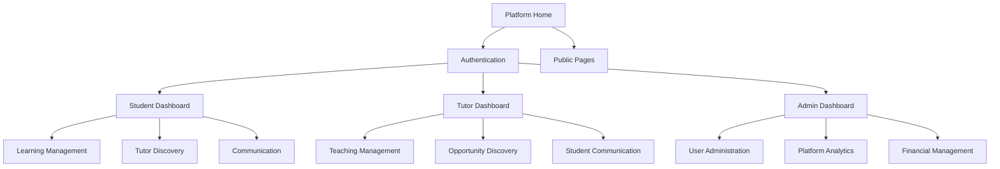
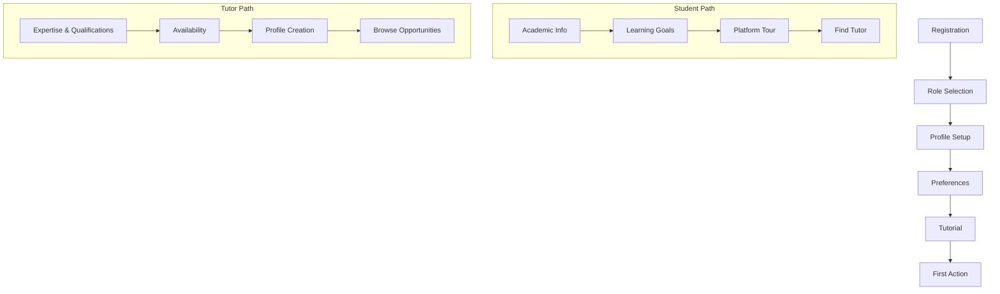
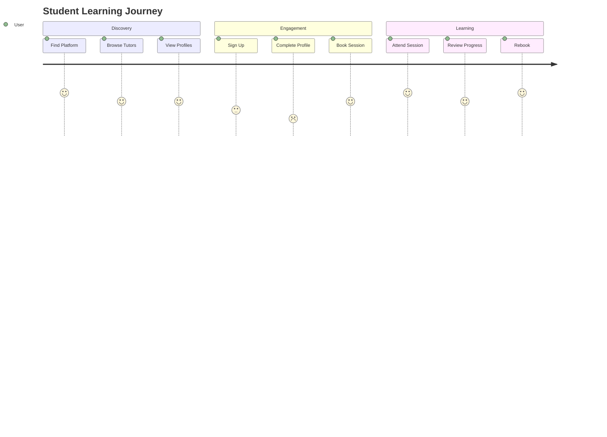
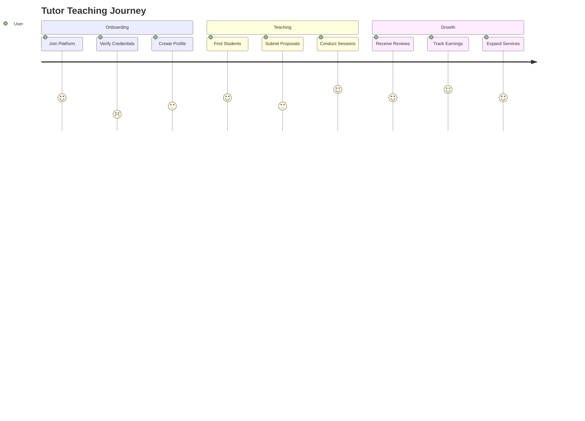

# Django Tutor Platform - Modern SaaS UI/UX Architecture Plan

## Executive Summary

This document outlines a comprehensive UI/UX architecture plan to transform the Django Tutor Platform into a modern, competitive SaaS application. The plan addresses current weaknesses while building upon existing strengths, focusing on creating a cohesive, scalable, and user-centric experience.

## Current State Analysis

### Strengths
- Modern tech stack with Bootstrap 5, HTMX, and Alpine.js
- Existing ui_components app with good foundation
- Theme support (light/dark mode)
- Responsive design considerations
- Component-based approach with template tags

### Identified Weaknesses
- Dual template system causing inconsistencies
- Navigation complexity and information overload
- Limited personalization capabilities
- Missing modern SaaS features (PWA, advanced visualizations)
- Inconsistent design patterns across components
- No comprehensive design system governance

## 1. Design System Architecture

### 1.1 Color Palette with Semantic Naming

```css
:root {
  /* Primary Brand Colors - Semantic Naming */
  --color-primary-50: #eff6ff;
  --color-primary-100: #dbeafe;
  --color-primary-200: #bfdbfe;
  --color-primary-300: #93c5fd;
  --color-primary-400: #60a5fa;
  --color-primary-500: #3b82f6;  /* Main primary */
  --color-primary-600: #2563eb;
  --color-primary-700: #1d4ed8;
  --color-primary-800: #1e40af;
  --color-primary-900: #1e3a8a;

  /* Semantic Colors */
  --color-success: #10b981;
  --color-success-light: #d1fae5;
  --color-warning: #f59e0b;
  --color-warning-light: #fef3c7;
  --color-danger: #ef4444;
  --color-danger-light: #fee2e2;
  --color-info: #06b6d4;
  --color-info-light: #cffafe;

  /* Neutral Colors */
  --color-gray-50: #f9fafb;
  --color-gray-100: #f3f4f6;
  --color-gray-200: #e5e7eb;
  --color-gray-300: #d1d5db;
  --color-gray-400: #9ca3af;
  --color-gray-500: #6b7280;
  --color-gray-600: #4b5563;
  --color-gray-700: #374151;
  --color-gray-800: #1f2937;
  --color-gray-900: #111827;

  /* Role-Specific Colors */
  --color-student: #8b5cf6;    /* Purple */
  --color-tutor: #0ea5e9;      /* Sky blue */
  --color-admin: #f97316;      /* Orange */
}
```

### 1.2 Typography Scale and Hierarchy

```css
:root {
  /* Font Families */
  --font-sans: 'Inter', -apple-system, BlinkMacSystemFont, 'Segoe UI', Roboto, sans-serif;
  --font-mono: 'JetBrains Mono', 'Fira Code', Consolas, monospace;
  --font-display: 'Inter Display', 'Inter', sans-serif;

  /* Type Scale - Modular Scale (1.25) */
  --text-xs: 0.75rem;      /* 12px */
  --text-sm: 0.875rem;     /* 14px */
  --text-base: 1rem;       /* 16px */
  --text-lg: 1.125rem;     /* 18px */
  --text-xl: 1.25rem;      /* 20px */
  --text-2xl: 1.5rem;      /* 24px */
  --text-3xl: 1.875rem;    /* 30px */
  --text-4xl: 2.25rem;     /* 36px */
  --text-5xl: 3rem;        /* 48px */

  /* Line Heights */
  --leading-tight: 1.25;
  --leading-normal: 1.5;
  --leading-relaxed: 1.75;

  /* Font Weights */
  --font-light: 300;
  --font-normal: 400;
  --font-medium: 500;
  --font-semibold: 600;
  --font-bold: 700;
  --font-extrabold: 800;
}
```

### 1.3 Spacing System and Layout Grids

```css
:root {
  /* Spacing Scale - 8px base unit */
  --space-0: 0;
  --space-1: 0.25rem;  /* 4px */
  --space-2: 0.5rem;   /* 8px */
  --space-3: 0.75rem;  /* 12px */
  --space-4: 1rem;     /* 16px */
  --space-5: 1.25rem;  /* 20px */
  --space-6: 1.5rem;   /* 24px */
  --space-8: 2rem;     /* 32px */
  --space-10: 2.5rem;  /* 40px */
  --space-12: 3rem;    /* 48px */
  --space-16: 4rem;    /* 64px */
  --space-20: 5rem;    /* 80px */
  --space-24: 6rem;    /* 96px */

  /* Container Max Widths */
  --container-sm: 640px;
  --container-md: 768px;
  --container-lg: 1024px;
  --container-xl: 1280px;
  --container-2xl: 1536px;

  /* Grid System */
  --grid-cols: 12;
  --grid-gutter: var(--space-6);
}
```

### 1.4 Component Variant System

```css
/* Button Variants */
.btn {
  /* Base styles */
  transition: all 0.2s cubic-bezier(0.4, 0, 0.2, 1);
  border-radius: var(--radius-md);
  font-weight: var(--font-medium);
}

.btn-variant-primary { /* Primary button styles */ }
.btn-variant-secondary { /* Secondary button styles */ }
.btn-variant-ghost { /* Ghost button styles */ }
.btn-variant-link { /* Link button styles */ }

/* Size Variants */
.btn-size-xs { padding: var(--space-1) var(--space-2); }
.btn-size-sm { padding: var(--space-2) var(--space-3); }
.btn-size-md { padding: var(--space-3) var(--space-4); }
.btn-size-lg { padding: var(--space-4) var(--space-6); }
.btn-size-xl { padding: var(--space-5) var(--space-8); }
```

### 1.5 Icon System and Illustrations

```css
:root {
  /* Icon Sizes */
  --icon-xs: 1rem;
  --icon-sm: 1.25rem;
  --icon-md: 1.5rem;
  --icon-lg: 2rem;
  --icon-xl: 2.5rem;
}

/* Custom Icon Library Structure */
.tutor-icons {
  /* Education-specific icons */
  --icon-book: "📚";
  --icon-graduation-cap: "🎓";
  --icon-classroom: "🏫";
  --icon-presentation: "📊";
  --icon-certificate: "🏆";
}
```

## 2. Information Architecture

### 2.1 Simplified Navigation Structure

#### Student Navigation
```
Dashboard
├── Overview
├── My Learning
│   ├── Active Sessions
│   ├── Completed Sessions
│   └── Learning Path
├── Find Tutors
│   ├── Browse
│   ├── Search
│   └── Recommendations
├── Schedule
├── Messages
└── Profile
```

#### Tutor Navigation
```
Dashboard
├── Overview
├── My Teaching
│   ├── Upcoming Sessions
│   ├── Student Progress
│   └── Earnings
├── Find Opportunities
│   ├── Job Board
│   ├── Student Requests
│   └── Matching
├── Schedule
├── Messages
└── Profile
```

#### Admin Navigation
```
Dashboard
├── Overview
├── User Management
│   ├── Students
│   ├── Tutors
│   └── Admins
├── Content Management
├── Analytics
├── Financial
└── Settings
```

### 2.2 Improved Content Hierarchy



### 2.3 Search and Discovery System

```python
# Enhanced Search Architecture
class SearchSystem:
    """
    Unified search system with intelligent recommendations
    """
    
    def __init__(self):
        self.search_types = {
            'tutors': TutorSearchEngine(),
            'requirements': RequirementSearchEngine(),
            'content': ContentSearchEngine(),
            'help': HelpSearchEngine()
        }
    
    def unified_search(self, query, user_type, context):
        """
        Perform intelligent search based on user type and context
        """
        results = {}
        
        # Prioritize search results based on user type
        if user_type == 'STUDENT':
            priority_order = ['tutors', 'requirements', 'content', 'help']
        elif user_type == 'TUTOR':
            priority_order = ['requirements', 'tutors', 'content', 'help']
        else:
            priority_order = ['content', 'help', 'tutors', 'requirements']
        
        for search_type in priority_order:
            results[search_type] = self.search_types[search_type].search(
                query, user_context=context
            )
        
        return results
```

### 2.4 User Onboarding Flow Design



## 3. Component Architecture

### 3.1 Enhanced Component Library Structure

```
ui_components/
├── templates/
│   ├── ui_components/
│   │   ├── base/
│   │   │   ├── layout.html
│   │   │   ├── header.html
│   │   │   ├── sidebar.html
│   │   │   └── footer.html
│   │   ├── navigation/
│   │   │   ├── navbar.html
│   │   │   ├── breadcrumbs.html
│   │   │   ├── tabs.html
│   │   │   └── pagination.html
│   │   ├── forms/
│   │   │   ├── input.html
│   │   │   ├── select.html
│   │   │   ├── checkbox.html
│   │   │   ├── radio.html
│   │   │   ├── textarea.html
│   │   │   └── form_group.html
│   │   ├── feedback/
│   │   │   ├── alert.html
│   │   │   ├── toast.html
│   │   │   ├── badge.html
│   │   │   ├── progress.html
│   │   │   └── spinner.html
│   │   ├── data/
│   │   │   ├── table.html
│   │   │   ├── card.html
│   │   │   ├── list.html
│   │   │   ├── chart.html
│   │   │   └── calendar.html
│   │   ├── overlays/
│   │   │   ├── modal.html
│   │   │   ├── dropdown.html
│   │   │   ├── tooltip.html
│   │   │   └── popover.html
│   │   └── specialized/
│   │       ├── tutor_card.html
│   │       ├── session_card.html
│   │       ├── requirement_card.html
│   │       ├── message_thread.html
│   │       └── dashboard_widget.html
├── static/
│   ├── ui_components/
│   │   ├── css/
│   │   │   ├── components/
│   │   │   │   ├── buttons.css
│   │   │   │   ├── forms.css
│   │   │   │   ├── navigation.css
│   │   │   │   ├── feedback.css
│   │   │   │   └── data.css
│   │   │   ├── layouts/
│   │   │   ├── themes/
│   │   │   └── utilities/
│   │   └── js/
│   │       ├── components/
│   │       ├── utils/
│   │       └── plugins/
└── templatetags/
    ├── ui_components.py
    └── ui_filters.py
```

### 3.2 Component Variants for Different Contexts

```python
# Component Variant System
class ComponentVariant:
    """
    System for managing component variants based on context
    """
    
    VARIANTS = {
        'button': {
            'primary': {'class': 'btn-primary', 'icon': None},
            'secondary': {'class': 'btn-secondary', 'icon': None},
            'success': {'class': 'btn-success', 'icon': 'check'},
            'danger': {'class': 'btn-danger', 'icon': 'x'},
            'ghost': {'class': 'btn-ghost', 'icon': None},
            'link': {'class': 'btn-link', 'icon': None}
        },
        'card': {
            'default': {'class': 'card-default'},
            'elevated': {'class': 'card-elevated'},
            'bordered': {'class': 'card-bordered'},
            'interactive': {'class': 'card-interactive'},
            'compact': {'class': 'card-compact'}
        }
    }
```

### 3.3 Interaction Patterns and Micro-animations

```css
/* Micro-animation System */
:root {
  /* Animation Durations */
  --duration-fast: 150ms;
  --duration-normal: 250ms;
  --duration-slow: 350ms;
  
  /* Animation Easings */
  --ease-in: cubic-bezier(0.4, 0, 1, 1);
  --ease-out: cubic-bezier(0, 0, 0.2, 1);
  --ease-in-out: cubic-bezier(0.4, 0, 0.2, 1);
  
  /* Animation Presets */
  --animation-bounce: bounce 0.6s ease-in-out;
  --animation-fade-in: fadeIn 0.3s ease-out;
  --animation-slide-up: slideUp 0.3s ease-out;
  --animation-scale-in: scaleIn 0.2s ease-out;
}

/* Hover States */
.interactive-element {
  transition: transform var(--duration-fast) var(--ease-out),
              box-shadow var(--duration-normal) var(--ease-out);
}

.interactive-element:hover {
  transform: translateY(-2px);
  box-shadow: 0 4px 12px rgba(0, 0, 0, 0.15);
}

/* Loading States */
.loading-skeleton {
  background: linear-gradient(90deg, #f0f0f0 25%, #e0e0e0 50%, #f0f0f0 75%);
  background-size: 200% 100%;
  animation: loading 1.5s infinite;
}
```

### 3.4 Responsive Design Patterns

```css
/* Responsive Container System */
.container-responsive {
  width: 100%;
  margin: 0 auto;
  padding: 0 var(--space-4);
}

@media (min-width: 640px) {
  .container-responsive {
    max-width: var(--container-sm);
    padding: 0 var(--space-6);
  }
}

@media (min-width: 1024px) {
  .container-responsive {
    max-width: var(--container-lg);
    padding: 0 var(--space-8);
  }
}

/* Adaptive Navigation */
.nav-adaptive {
  /* Mobile-first approach */
}

@media (min-width: 768px) {
  .nav-adaptive {
    /* Tablet styles */
  }
}

@media (min-width: 1024px) {
  .nav-adaptive {
    /* Desktop styles */
  }
}
```

## 4. User Experience Flows

### 4.1 Key User Journey Mapping

#### Student Journey


#### Tutor Journey


### 4.2 Dashboard Personalization Strategy

```python
class PersonalizedDashboard:
    """
    Dynamic dashboard system that adapts to user behavior and preferences
    """
    
    def __init__(self, user):
        self.user = user
        self.user_type = user.user_type
        self.preferences = self.get_user_preferences()
        self.behavior_data = self.get_behavior_data()
    
    def get_widgets(self):
        """
        Return personalized widgets based on user type and behavior
        """
        base_widgets = self.get_base_widgets()
        personalized_widgets = self.get_personalized_widgets()
        
        return self.optimize_widget_order(
            base_widgets + personalized_widgets
        )
    
    def get_personalized_widgets(self):
        """
        Generate widgets based on user behavior patterns
        """
        widgets = []
        
        if self.user_type == 'STUDENT':
            # Learning progress widget
            if self.behavior_data.get('recent_sessions'):
                widgets.append(self.create_learning_progress_widget())
            
            # Recommended tutors widget
            if self.behavior_data.get('search_history'):
                widgets.append(self.create_recommendations_widget())
        
        elif self.user_type == 'TUTOR':
            # Earnings widget
            if self.behavior_data.get('completed_sessions'):
                widgets.append(self.create_earnings_widget())
            
            # Student opportunities widget
            widgets.append(self.create_opportunities_widget())
        
        return widgets
```

### 4.3 Improved Form Experiences with Multi-Step Forms

```python
class MultiStepForm:
    """
    Enhanced multi-step form system with progress tracking
    and smart validation
    """
    
    def __init__(self, steps, form_data=None):
        self.steps = steps
        self.current_step = 0
        self.form_data = form_data or {}
        self.validation_errors = {}
    
    def get_current_step(self):
        """
        Get current step with context
        """
        return {
            'step': self.steps[self.current_step],
            'progress': (self.current_step + 1) / len(self.steps) * 100,
            'is_first': self.current_step == 0,
            'is_last': self.current_step == len(self.steps) - 1,
            'can_proceed': self.validate_current_step()
        }
    
    def next_step(self):
        """
        Move to next step if current step is valid
        """
        if self.validate_current_step():
            self.current_step += 1
            return True
        return False
    
    def validate_current_step(self):
        """
        Validate current step with smart error handling
        """
        step = self.steps[self.current_step]
        validator = step.get('validator')
        
        if validator:
            is_valid, errors = validator(self.form_data)
            self.validation_errors = errors
            return is_valid
        
        return True
```

### 4.4 Enhanced Data Presentation with Interactive Tables and Visualizations

```python
class InteractiveDataTable:
    """
    Advanced data table with sorting, filtering, and visualization
    """
    
    def __init__(self, data, columns):
        self.data = data
        self.columns = columns
        self.filters = {}
        self.sort_column = None
        self.sort_direction = 'asc'
    
    def render_with_visualizations(self):
        """
        Render table with integrated charts and visualizations
        """
        context = {
            'table_data': self.get_filtered_sorted_data(),
            'columns': self.columns,
            'summary_stats': self.calculate_summary_stats(),
            'charts': self.generate_charts(),
            'export_options': self.get_export_options()
        }
        
        return context
    
    def generate_charts(self):
        """
        Generate relevant charts based on data
        """
        charts = []
        
        # Trend chart for time-series data
        if self.has_time_column():
            charts.append(self.create_trend_chart())
        
        # Distribution chart for categorical data
        if self.has_categorical_column():
            charts.append(self.create_distribution_chart())
        
        return charts
```

## 5. Technical Architecture

### 5.1 Template Organization Strategy

```
templates/
├── base/
│   ├── base.html              # Main base template
│   ├── base_auth.html         # Authenticated base
│   ├── base_public.html       # Public base
│   └── base_admin.html        # Admin base
├── layouts/
│   ├── dashboard.html         # Dashboard layout
│   ├── full_width.html        # Full width layout
│   ├── sidebar.html           # Sidebar layout
│   └── minimal.html           # Minimal layout
├── partials/
│   ├── navigation/            # Navigation partials
│   ├── forms/                # Form partials
│   ├── cards/                # Card partials
│   └── modals/               # Modal partials
└── pages/
    ├── auth/                 # Authentication pages
    ├── dashboard/            # Dashboard pages
    ├── profiles/             # Profile pages
    └── admin/                # Admin pages
```

### 5.2 Asset Optimization Approach

```python
# Asset Management Strategy
class AssetOptimizer:
    """
    Advanced asset optimization system
    """
    
    def __init__(self):
        self.optimization_strategies = {
            'css': self.optimize_css,
            'js': self.optimize_js,
            'images': self.optimize_images
        }
    
    def optimize_css(self, css_files):
        """
        Optimize CSS with purging, minification, and critical path extraction
        """
        # Purge unused CSS
        purged_css = self.purge_unused_css(css_files)
        
        # Minify CSS
        minified_css = self.minify_css(purged_css)
        
        # Extract critical CSS
        critical_css = self.extract_critical_css(minified_css)
        
        return {
            'critical': critical_css,
            'deferred': minified_css
        }
    
    def optimize_js(self, js_files):
        """
        Optimize JavaScript with bundling, minification, and tree shaking
        """
        # Bundle JavaScript modules
        bundled_js = self.bundle_js(js_files)
        
        # Tree shake unused code
        shaken_js = self.tree_shake_js(bundled_js)
        
        # Minify JavaScript
        minified_js = self.minify_js(shaken_js)
        
        return minified_js
```

### 5.3 State Management for Complex Interactions

```javascript
// Alpine.js Store for Global State Management
document.addEventListener('alpine:init', () => {
    Alpine.store('app', {
        // User state
        user: null,
        userPreferences: {},
        
        // UI state
        sidebarOpen: false,
        theme: 'light',
        notifications: [],
        
        // Data state
        dashboardData: {},
        searchResults: {},
        
        // Initialize store
        init() {
            this.loadUserPreferences();
            this.initializeTheme();
            this.setupWebSocketConnection();
        },
        
        // User preference management
        loadUserPreferences() {
            const saved = localStorage.getItem('userPreferences');
            if (saved) {
                this.userPreferences = JSON.parse(saved);
            }
        },
        
        saveUserPreferences() {
            localStorage.setItem('userPreferences', JSON.stringify(this.userPreferences));
        },
        
        // Theme management
        initializeTheme() {
            const savedTheme = localStorage.getItem('theme') || 'light';
            this.theme = savedTheme;
            document.documentElement.setAttribute('data-theme', savedTheme);
        },
        
        toggleTheme() {
            this.theme = this.theme === 'light' ? 'dark' : 'light';
            document.documentElement.setAttribute('data-theme', this.theme);
            localStorage.setItem('theme', this.theme);
        },
        
        // WebSocket connection for real-time updates
        setupWebSocketConnection() {
            if (this.user) {
                const ws = new WebSocket(`ws://${window.location.host}/ws/notifications/`);
                
                ws.onmessage = (event) => {
                    const notification = JSON.parse(event.data);
                    this.notifications.unshift(notification);
                };
            }
        }
    });
});
```

### 5.4 Performance Optimization Strategies

```python
# Performance Optimization System
class PerformanceOptimizer:
    """
    Comprehensive performance optimization system
    """
    
    def __init__(self):
        self.strategies = {
            'caching': self.implement_caching,
            'lazy_loading': self.implement_lazy_loading,
            'code_splitting': self.implement_code_splitting,
            'image_optimization': self.optimize_images,
            'cdn_integration': self.integrate_cdn
        }
    
    def implement_caching(self):
        """
        Implement multi-level caching strategy
        """
        return {
            'browser_cache': self.setup_browser_cache_headers(),
            'cdn_cache': self.setup_cdn_cache(),
            'application_cache': self.setup_application_cache(),
            'database_cache': self.setup_database_cache()
        }
    
    def implement_lazy_loading(self):
        """
        Implement lazy loading for images and components
        """
        return {
            'image_lazy_loading': self.setup_image_lazy_loading(),
            'component_lazy_loading': self.setup_component_lazy_loading(),
            'route_lazy_loading': self.setup_route_lazy_loading()
        }
```

## 6. SaaS-Specific Features

### 6.1 PWA Implementation Strategy

```javascript
// Service Worker for PWA Functionality
const CACHE_NAME = 'tutor-platform-v1';
const urlsToCache = [
    '/',
    '/static/ui_components/css/main.css',
    '/static/ui_components/js/main.js',
    '/offline/'
];

self.addEventListener('install', (event) => {
    event.waitUntil(
        caches.open(CACHE_NAME)
            .then((cache) => cache.addAll(urlsToCache))
    );
});

self.addEventListener('fetch', (event) => {
    event.respondWith(
        caches.match(event.request)
            .then((response) => {
                // Cache hit - return response
                if (response) {
                    return response;
                }
                
                // Network request
                return fetch(event.request)
                    .then((response) => {
                        // Check if valid response
                        if (!response || response.status !== 200 || response.type !== 'basic') {
                            return response;
                        }
                        
                        // Clone response for caching
                        const responseToCache = response.clone();
                        
                        caches.open(CACHE_NAME)
                            .then((cache) => {
                                cache.put(event.request, responseToCache);
                            });
                        
                        return response;
                    })
                    .catch(() => {
                        // Offline fallback
                        return caches.match('/offline/');
                    });
            })
    );
});
```

### 6.2 Real-time Collaboration Features

```python
# WebSocket-based Real-time System
class RealTimeCollaboration:
    """
    Real-time collaboration system for tutoring sessions
    """
    
    def __init__(self):
        self.active_sessions = {}
        self.user_connections = {}
    
    async def handle_websocket_connection(self, websocket, user_id):
        """
        Handle WebSocket connection for real-time features
        """
        self.user_connections[user_id] = websocket
        
        try:
            async for message in websocket:
                data = json.loads(message)
                await self.process_message(user_id, data)
        finally:
            del self.user_connections[user_id]
    
    async def process_message(self, user_id, data):
        """
        Process real-time messages
        """
        message_type = data.get('type')
        
        if message_type == 'join_session':
            await self.handle_session_join(user_id, data)
        elif message_type == 'chat_message':
            await self.handle_chat_message(user_id, data)
        elif message_type == 'whiteboard_update':
            await self.handle_whiteboard_update(user_id, data)
        elif message_type == 'screen_share':
            await self.handle_screen_share(user_id, data)
```

### 6.3 Analytics and Reporting Interfaces

```python
# Advanced Analytics System
class AnalyticsEngine:
    """
    Comprehensive analytics system for SaaS metrics
    """
    
    def __init__(self):
        self.metrics_collectors = {
            'user_engagement': UserEngagementCollector(),
            'learning_progress': LearningProgressCollector(),
            'financial_metrics': FinancialMetricsCollector(),
            'platform_usage': PlatformUsageCollector()
        }
    
    def generate_dashboard_data(self, user_type, time_range):
        """
        Generate personalized dashboard analytics
        """
        data = {}
        
        if user_type == 'STUDENT':
            data = self.generate_student_analytics(time_range)
        elif user_type == 'TUTOR':
            data = self.generate_tutor_analytics(time_range)
        elif user_type == 'ADMIN':
            data = self.generate_admin_analytics(time_range)
        
        return {
            'metrics': data,
            'charts': self.generate_charts(data),
            'insights': self.generate_insights(data),
            'recommendations': self.generate_recommendations(data)
        }
```

### 6.4 A/B Testing Framework Integration

```python
# A/B Testing Framework
class ABTestingFramework:
    """
    A/B testing framework for UI/UX optimization
    """
    
    def __init__(self):
        self.experiments = {}
        self.user_assignments = {}
    
    def create_experiment(self, name, variants, traffic_split):
        """
        Create new A/B test experiment
        """
        self.experiments[name] = {
            'variants': variants,
            'traffic_split': traffic_split,
            'results': {variant: {'impressions': 0, 'conversions': 0} 
                       for variant in variants}
        }
    
    def assign_variant(self, user_id, experiment_name):
        """
        Assign user to variant
        """
        if user_id in self.user_assignments.get(experiment_name, {}):
            return self.user_assignments[experiment_name][user_id]
        
        experiment = self.experiments[experiment_name]
        variant = self.select_variant(experiment['traffic_split'])
        
        self.user_assignments.setdefault(experiment_name, {})[user_id] = variant
        return variant
    
    def track_conversion(self, user_id, experiment_name, conversion_type):
        """
        Track conversion for A/B test
        """
        if user_id in self.user_assignments.get(experiment_name, {}):
            variant = self.user_assignments[experiment_name][user_id]
            self.experiments[experiment_name]['results'][variant]['conversions'] += 1
```

## 7. Implementation Roadmap

### Phase 1: Foundation (Weeks 1-4)
1. Design System Implementation
   - Color palette and typography system
   - Spacing and layout grids
   - Base component variants

2. Template Architecture Restructuring
   - New template hierarchy
   - Base template optimization
   - Component organization

3. Core Component Enhancement
   - Button, form, and card components
   - Navigation components
   - Feedback components

### Phase 2: User Experience (Weeks 5-8)
1. Navigation Simplification
   - Role-based navigation implementation
   - Improved information architecture
   - Search and discovery system

2. Dashboard Personalization
   - Dynamic dashboard system
   - User preference management
   - Personalized widgets

3. Form Enhancement
   - Multi-step form system
   - Improved validation
   - Better error handling

### Phase 3: Advanced Features (Weeks 9-12)
1. Data Visualization
   - Interactive charts and graphs
   - Advanced table components
   - Analytics dashboards

2. Performance Optimization
   - Asset optimization
   - Lazy loading implementation
   - Caching strategies

3. Accessibility Improvements
   - ARIA labels and roles
   - Keyboard navigation
   - Screen reader support

### Phase 4: SaaS Features (Weeks 13-16)
1. PWA Implementation
   - Service worker setup
   - Offline functionality
   - App manifest

2. Real-time Features
   - WebSocket implementation
   - Live notifications
   - Collaboration tools

3. Analytics and Testing
   - A/B testing framework
   - User analytics
   - Performance monitoring

## Conclusion

This comprehensive UI/UX architecture plan provides a roadmap to transform the Django Tutor Platform into a modern, competitive SaaS application. The focus on creating a cohesive design system, improving user experience, and implementing advanced SaaS features will position the platform for growth and success.

The implementation is structured in phases to ensure manageable development cycles while delivering value to users at each stage. The modular approach allows for flexibility and adaptation based on user feedback and changing requirements.